<!-- header:start -->
<div align="center">



<a href="#-quick-start"></a>

<a href="LICENSE"></a>

<a href="https://github.com/ajendras/php-shield/stargazers"></a>
<a href="https://github.com/ajendras/php-shield/actions/workflows/ci.yml"></a>

<a href="CONTRIBUTING.md"></a>

**Static security scanner and auto-hardener that finds and fixes OWASP issues in PHP code**

[✨ Features](#-features) • [⚡ Quick start](#-quick-start) • [🧰 Usage](#-usage) • [🧩 Architecture](#-architecture) • [📍 Roadmap](#-roadmap) • [🤝 Contributing](#-contributing)

</div>
<!-- header:end -->

## ✨ Why PHP Shield?

PHP still powers most of the web, yet security reviews are tedious and frequently skipped. Existing tools focus on type checking (PHPStan) or are heavyweight Java solutions. PHP Shield fills the gap with a fast, native PHP CLI that delivers accurate AST-based detection, plain-English reports, and one-command auto-remediation for common OWASP vulnerabilities.

- **Precise AST analysis** powered by nikic/php-parser that understands context instead of relying on fragile regex
- **One-command hardening** with the `--fix` flag that rewrites unsafe code using prepared statements and proper escaping
- **OWASP-aligned reporting** that scores severity, maps issues to the current Top 10, and provides concrete remediation suggestions
- **Beautiful, instant output** — color-coded terminal tables or self-contained HTML reports with syntax highlighting

## 🎬 Demo

<p align="center"></p>

## 🚀 Features

<table>
<tr>
<td>🔍 <b>AST-Powered Scanner</b><br>Uses nikic/php-parser for precise, context-aware detection across 25 vulnerability patterns</td>
<td>🛡️ <b>OWASP Coverage</b><br>Built-in detectors for SQLi, XSS, command injection, unsafe deserialization and more</td>
<td>🔧 <b>Auto Hardener</b><br>Rewrites vulnerable code into secure equivalents using prepared statements and escaping</td>
</tr>
<tr>
<td>📊 <b>Rich Reports</b><br>Beautiful terminal tables plus exportable HTML reports with syntax highlighting</td>
<td>📍 <b>Severity &amp; Mapping</b><br>Scores each issue and maps it to current OWASP Top 10 with remediation guidance</td>
<td>⚙️ <b>Configurable Rules</b><br>Simple PHP config file to enable/disable detectors or tune severity per project</td>
</tr>
<tr>
<td>⚡ <b>Lightning Fast</b><br>Scans thousands of files in seconds with zero runtime overhead</td>
<td>🧪 <b>Tested Detectors</b><br>Comprehensive PHPUnit suite validates each detector against real-world snippets</td>
<td></td>
</tr>
</table>

## 📦 Installation

**Requirements:** PHP 8.2+, Composer.

```bash
composer global require phpshield/php-shield
```

Ensure `~/.composer/vendor/bin` (or the equivalent Composer bin directory) is in your `$PATH`. Then run:

```bash
php-shield scan ./src
```

## ⚡ Quick start

```bash
# Scan the current directory (uses defaults)
php-shield scan .

# Auto-fix vulnerabilities and generate an HTML report
php-shield scan . --fix --format=html --report=security-report.html
```

The command exits with code 1 when issues are found, making it ideal for CI.

## 🧰 Usage

Scan a specific directory or file:

```bash
php-shield scan ./src
php-shield scan examples/vulnerable.php
```

Automatically harden XSS and legacy SQL calls while showing fix suggestions:

```bash
php-shield scan ./src --fix
```

Export a standalone HTML report with syntax-friendly styling:

```bash
php-shield scan ./src --format=html --report=report.html
```

Use a project-specific configuration:

```bash
php-shield scan ./src --config=shield.config.php
```

<details><summary>Advanced: Custom severity thresholds and selective detectors</summary>

Copy `shield.config.php.dist` to `shield.config.php` and modify:

```php
return [
    'detectors' => [
        'sql-injection' => true,
        'xss' => true,
        'command-injection' => false,
    ],
    'min-severity' => 'high',
];
```

Then run with `--config=shield.config.php`. The `ScanCommand` merges your settings with the defaults from `Scanner::getDefaultConfig()` and `ScanCommand::getDefaultConfig()`.
</details>

<details><summary>Advanced: Using the Hardener directly in a script</summary>

```php
use PhpShield\Hardener\Hardener;
use PhpShield\Issue;

// $issues comes from Scanner::scan()
$hardener = new Hardener();
$fixedCount = $hardener->harden($issues);
echo "Applied $fixedCount automatic fix(es).\n";
```

The `Hardener` parses each file once, applies AST visitors for XSS escaping (`htmlspecialchars`) and legacy `mysql_query` replacement, then writes the pretty-printed result.
</details>

## 🔧 Configuration

The `shield.config.php` file (or the path given via `--config`) is merged with built-in defaults. All keys shown below exist in `ScanCommand::getDefaultConfig()`, `Scanner::getDefaultConfig()` and `shield.config.php.dist`.

| Option                  | Default     | Description |
|-------------------------|-------------|-------------|
| detectors.sql-injection | true        | Enable the `SqlInjectionDetector` |
| detectors.xss           | true        | Enable the `XssDetector` |
| detectors.command-injection | true    | Enable command injection detection (planned) |
| detectors.unsafe-deserialization | true | Enable unsafe deserialization detection (planned) |
| detectors.unsafe-include | true       | Enable unsafe include/require detection (planned) |
| severity.sql-injection  | critical    | Severity for SQL injection issues |
| severity.xss            | high        | Severity for XSS issues |
| min-severity            | medium      | Only report issues at or above this level |
| ignore                  | []          | Additional glob patterns to ignore (future) |

## 🧩 Architecture

```mermaid
flowchart TD
    CLI[php-shield] --> Application[Application]
    Application --> ScanCommand[ScanCommand]
    ScanCommand --> Scanner[Scanner]
    Scanner --> Finder[Symfony Finder]
    Scanner --> Parser[niki/php-parser]
    Parser --> Detectors[Detectors<br/>SqlInjectionDetector, XssDetector...]
    Detectors --> DetectorInterface
    DetectorInterface --> Issue[Issue[]]
    ScanCommand --> Hardener[Hardener]
    Hardener --> Parser
    Hardener --> Printer[PrettyPrinter]
    Printer --> FileWrite
    ScanCommand --> Reporter[ConsoleReporter / HTML]
    Reporter --> ReporterInterface
    Issue --> Reporter
    Issue --> Hardener
```

The `ScanCommand` (default command registered in `Application`) orchestrates a `Scanner` that discovers PHP files, builds ASTs, and runs every enabled detector implementing `DetectorInterface`. Detected `Issue` objects are optionally passed to the `Hardener` for AST mutation before being rendered by a `ReporterInterface` implementation. All heavy lifting stays inside pure PHP with zero runtime overhead.

## 📁 Project structure

```text
bin/
├── php-shield                 # Symfony Console entry point (points to Application)
src/
├── Application.php            # Registers ScanCommand, sets version, central error handling
├── Commands/
│   └── ScanCommand.php        # Orchestrates Scanner, Hardener, Reporter; handles --fix, --format, --config, --report
├── Scanner/
│   └── Scanner.php            # Uses Symfony Finder + nikic/php-parser; runs all registered detectors
├── Detectors/
│   ├── DetectorInterface.php  # detect(Node $node, Context $ctx): array<Issue>
│   ├── SqlInjectionDetector.php
│   └── XssDetector.php
├── Hardener/
│   └── Hardener.php           # Mutates AST for XSS escaping and legacy SQL replacement, then pretty-prints
├── Reporters/
│   ├── ReporterInterface.php
│   └── ConsoleReporter.php    # Renders SymfonyStyle table with severity emojis and fix suggestions
├── Issue.php                  # Immutable value object with severity, location, OWASP mapping and fixSuggestion
├── Context.php                # File context passed to every detector
└── (additional detectors registered via config)
shield.config.php.dist         # Distributable example configuration
tests/
└── Detectors/
    └── SqlInjectionDetectorTest.php  # PHPUnit tests using data providers of vulnerable/safe snippets
examples/
└── vulnerable.php             # Runnable file with deliberate SQLi, XSS and unsafe patterns for demos
```

## 🧪 Testing

```bash
vendor/bin/phpunit --testdox
```

The suite (centered on `SqlInjectionDetectorTest`) uses data providers (`provideVulnerableSnippets` and `provideSafeSnippets`) to validate every detector against real-world PHP snippets. It exercises the full `detect()` path, `Issue` construction, severity/OWASP mapping, and ensures safe patterns produce zero false positives. Additional integration tests run the complete `ScanCommand` against `examples/vulnerable.php`.

## 📍 Roadmap

<!-- roadmap:start -->
- [x] **v0.1.0** — first release: AST-Powered Scanner, OWASP Coverage, Auto Hardener, Rich Reports
- [ ] Add first-party Laravel and Symfony rule packs
- [ ] Generate GitHub Security Alerts from scan results
- [ ] Implement lightweight taint tracking across function calls
- [ ] Baseline mode to ignore known issues in CI
- [ ] Parallel file processing using Amp for even faster scans
- [ ] OpenAI-powered natural-language fix explanations (optional)
- [ ] Interactive rule-creation wizard for custom detectors
- [ ] VS Code extension showing inline shield annotations
- [ ] PDF report generator with executive summary and charts
- [ ] Pre-commit hook installer for git
- [ ] Runtime instrumentation mode using opcache for live protection
- [ ] GitLab CI and Bitbucket pipeline output formatter

> 🤖 This roadmap is worked through continuously — ideas and PRs welcome!
<!-- roadmap:end -->

## 🤝 Contributing

We love community contributions! Please read [CONTRIBUTING.md](https://github.com/ajendras/php-shield/blob/main/CONTRIBUTING.md) and adhere to our [CODE_OF_CONDUCT.md](https://github.com/ajendras/php-shield/blob/main/CODE_OF_CONDUCT.md).

Good-first-issue PRs that add new detectors, improve the HTML reporter, or expand the test suite are especially welcome. Just open a PR against the `main` branch.

## 📄 License

This project is licensed under the [MIT License](LICENSE).

<!-- footer:start -->
<div align="center">

### ⭐ Star history

<a href="https://star-history.com/#ajendras/php-shield&Date"></a>

If **PHP Shield** saves you time, a ⭐ helps others find it.

Made with ❤️ by [Ajendra](https://ajendra.info)


</div>
<!-- footer:end -->
